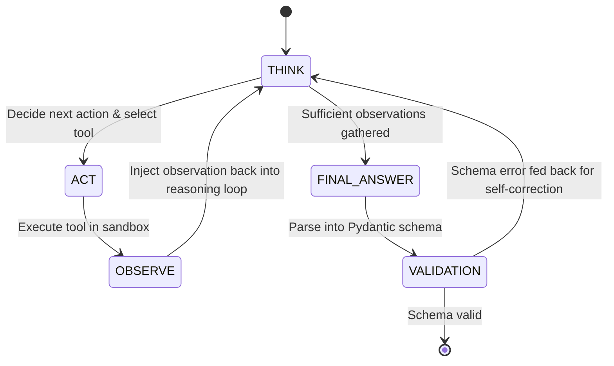

# NirmanAI (निर्माणAI)

> **Autonomous Multi-Agent System Architecture Synthesis & Self-Refining Evaluation Engine**

[](https://www.python.org/downloads/)
[](https://github.com/langchain-ai/langgraph)
[](https://docs.pydantic.dev/)
[](https://aistudio.google.com/)
[](https://huggingface.co/Qwen/Qwen2.5-7B-Instruct)
[](https://opensource.org/licenses/MIT)

---

## 1. Executive Overview

Designing scalable, fault-tolerant, and cost-effective distributed systems is one of the most intellectually demanding challenges in software engineering. When tasked with enterprise system design, general-purpose LLMs typically produce:
* **Superficial Buzzword Generation**: Recommending popular tools without justifying partition keys, caching topologies, or latency trade-offs.
* **Lack of Capacity Sizing**: Ignoring back-of-the-envelope calculations (QPS, ingress/egress bandwidth, storage growth, and cache sizing).
* **Single Points of Failure (SPOFs)**: Omitting circuit breakers, dead-letter queues, or multi-AZ redundancy.
* **No Validation or Self-Correction**: Failing to evaluate whether the proposed design meets non-functional SLAs.

**NirmanAI** transforms system design from a naive prompt-in/prompt-out query into an **autonomous, 6-phase engineering pipeline**. By orchestrating specialized ReAct agents through **LangGraph**, NirmanAI conducts automated domain research, calculates deterministic capacity math, drafts architectures via local GPU or cloud LLMs, subjects designs to a parallel panel of domain experts (Security, Database, SRE), and synthesizes production-ready dossiers and interactive Mermaid diagrams.

---

## 2. Core Innovations

1. **6-Phase Multi-Agent Pipeline**: Structured DAG orchestration powered by LangGraph, coordinating agents from prompt enrichment through expert critique and final dossier compilation.
2. **Autonomous ReAct Engine**: Agents utilize an iterative **Think → Act → Observe** loop equipped with live tools (`search_web`, `read_url`, `python_repl`, `validate_mermaid`) and schema self-correction.
3. **Deterministic Capacity Math Engine**: Replaces hallucinated figures with exact mathematical formulas for Peak QPS, storage projections (1-to-5-year growth with replication), network bandwidth, and RAM cache sizing.
4. **Parallel 3-Expert Panel Debate**: Architectures are audited simultaneously by dedicated **Security Lead**, **Database Architect**, and **SRE Lead** agents, followed by a **Lead Architect** that reconciles trade-offs and applies surgical patches.
5. **Dual-Inference Hybrid Architecture**:
   - **Local Mode**: 4-bit QLoRA fine-tuned `Qwen2.5-7B-Instruct` running locally on NVIDIA GPU (RTX A2000) for privacy and zero data leakage.
   - **Cloud Mode**: Google Gemini Free Tier with resilient multi-key load balancing and automatic HTTP 429 rotation across up to 9 API keys.
6. **Production-Grade Visual Topology**: Automatically generates dark-theme Mermaid.js diagrams with semantic subgraphs, protocol labels on all edges (`HTTPS`, `gRPC`, `WebSocket`, `Kafka`), and standardized node cards.
7. **210,000+ Curated Training Pairs**: Fine-tuned on real-world system design RFCs, postmortems, architecture decision records (ADRs), and detailed capacity dossiers.

---

## 3. End-to-End System Workflow

```mermaid
flowchart LR
    subgraph INPUT["1. Ingestion"]
        USER["User Requirement<br/>'Design an AI/ML Platform for 50M DAU'"]
    end

    subgraph PHASE0["Phase 0: Prompt Enhancement"]
        PE["PromptEnhancer Agent<br/>• Domain context injection<br/>• Web research & standards"]
    end

    subgraph PHASE1["Phase 1: Requirement Analysis"]
        RA["RequirementAnalyzer Agent<br/>• Functional & NFR extraction<br/>• Initial scale boundaries"]
    end

    subgraph PHASE2["Phase 2: Capacity Estimation"]
        CE["CapacityEstimator<br/>• Deterministic Python Math<br/>• Peak QPS, Storage, Cache"]
    end

    subgraph PHASE3["Phase 3: Architecture Generation"]
        LM["Local Qwen2.5-7B GPU<br/>(Domain Skeleton)"]
        AE["ArchitectureEnhancer<br/>(Gemini API Enriched Topology)"]
    end

    subgraph PHASE4["Phase 4: Expert Panel Review"]
        SEC["Security Lead"]
        DB["Database Architect"]
        SRE["SRE Lead"]
        LA["Lead Architect<br/>(Conflict Resolution & Patches)"]
    end

    subgraph PHASE5["Phase 5: Final Synthesis"]
        SYN["Synthesizer Agent<br/>• Markdown Dossier<br/>• Standalone HTML Dashboard"]
    end

    USER --> PE --> RA --> CE --> LM --> AE --> SEC & DB & SRE --> LA --> SYN

    classDef core fill:#0f172a,stroke:#38bdf8,color:#f8fafc,stroke-width:1px;
    classDef highlight fill:#1e293b,stroke:#0284c7,color:#f8fafc,stroke-width:2px;
    classDef expert fill:#312e81,stroke:#818cf8,color:#f8fafc,stroke-width:1px;
    classDef output fill:#064e3b,stroke:#34d399,color:#f8fafc,stroke-width:2px;

    class USER core;
    class PE,RA,CE,LM,AE highlight;
    class SEC,DB,SRE,LA expert;
    class SYN output;
```



---

## 4. Multi-Agent Roles & Execution Matrix

| Phase | Agent | Engine / Model | Core Responsibility |
|:---|:---|:---|:---|
| **Phase 0** | `PromptEnhancer` | ReAct + `search_web` | Detects domain, pulls current compliance standards (HIPAA, PCI-DSS, SOC2), enriches prompt. |
| **Phase 1** | `RequirementAnalyzer` | ReAct + Gemini | Extracts 4-6 Functional Requirements, 3-5 Non-Functional SLAs, verifies scale parameters. |
| **Phase 2** | `CapacityEstimator` | Deterministic Python | Computes Read/Write QPS, 5-year storage growth, cache memory (80/20 rule), network egress. |
| **Phase 3a** | `ArchitectureGenerator` | Fine-Tuned Qwen2.5-7B | Drafts raw domain-specific architecture skeleton with component boundaries on GPU. |
| **Phase 3b** | `ArchitectureEnhancer` | Gemini + Mermaid Rules | Expands skeleton into 12-16 enterprise components with dark-theme Mermaid diagram. |
| **Phase 4** | `ExpertPanel` (3 parallel) | ReAct Multi-Threading | • **Security Lead**: AuthN/AuthZ, mTLS, encryption, DDoS, WAF.<br/>• **Database Architect**: Sharding, replication, ACID vs CAP, cache invalidation.<br/>• **SRE Lead**: SPOF detection, multi-AZ, circuit breakers, dead-letter queues. |
| **Phase 4b** | `LeadArchitect` | ReAct Reconciler | Reconciles conflicting expert recommendations, applies patches, validates diagram syntax. |
| **Phase 5** | `Synthesizer` | Python Jinja2 Engine | Compiles final system design dossier into Markdown (`.md`) and interactive HTML dashboard. |

---

## 5. The Autonomous ReAct Engine

Every agent in NirmanAI inherits from the core `ReActEngine` (`nirman/agents/core/react_engine.py`):



### Available Autonomous Tools (`nirman/tools/`)
* **`search_web`**: Real-time web search via DuckDuckGo to look up architectural benchmarks and compliance rules.
* **`read_url`**: Fetches technical whitepapers, RFCs, and API documentation directly.
* **`python_repl`**: Executes Python calculations for non-trivial capacity formulas.
* **`validate_mermaid`**: Validates Mermaid.js diagram syntax and catches formatting errors before output generation.

---

## 6. Repository Structure

```
NirmanAI/
├── setup.ps1                           # Automated setup script for Windows PowerShell
├── setup.sh                            # Automated setup script for Linux / macOS / Git Bash
├── requirements.txt                    # Project dependencies
├── pyproject.toml                      # Build configuration & editable package setup
├── .env.example                        # Template for environment variables and API keys
├── README.md                           # Master documentation
├── ppt.md                              # Presentation slide deck & architectural report
│
├── nirman/                             # Core Python Package
│   ├── prompts.py                      # DRY shared Mermaid styling & diagram rules
│   │
│   ├── agents/                         # Agent Implementations
│   │   ├── core/                       # Core agent infrastructure
│   │   │   ├── react_engine.py         # Autonomous Think-Act-Observe ReAct loop
│   │   │   ├── gemini_client.py        # Gemini client with multi-key pool rotation
│   │   │   ├── local_model.py          # Local GPU model loader (4-bit QLoRA)
│   │   │   └── orchestrator.py         # Multi-agent coordination
│   │   ├── pipeline/                   # Production 6-phase pipeline agents
│   │   │   ├── enhancer.py             # Phase 0: PromptEnhancer
│   │   │   ├── analyzer.py             # Phase 1: RequirementAnalyzer
│   │   │   ├── estimator.py            # Phase 2: CapacityEstimator
│   │   │   ├── generator.py            # Phase 3a: ArchitectureGenerator
│   │   │   ├── architecture_enhancer.py# Phase 3b: ArchitectureEnhancer
│   │   │   ├── expert_panel.py         # Phase 4: ExpertPanel (3 experts + Lead Architect)
│   │   │   └── synthesizer.py          # Phase 5: Dossier & HTML Synthesizer
│   │   └── legacy/                     # Deprecated single-pass agents
│   │
│   ├── interfaces/                     # User Interfaces
│   │   ├── cli.py                      # Rich terminal CLI synthesizer
│   │   └── web_ui.py                   # Standalone prototype web dashboard
│   │
│   ├── schemas/                        # Pydantic v2 Strict Data Models
│   │   ├── pipeline/                   # Pipeline schemas (analyzer, estimator, dossier)
│   │   └── legacy/                     # Legacy schemas
│   │
│   ├── tools/                          # Autonomous Agent Tools
│   │   ├── registry.py                 # Tool registration & discovery
│   │   ├── research/                   # search_web, read_url
│   │   ├── execution/                  # python_repl
│   │   └── validation/                 # validate_mermaid
│   │
│   └── workflow/                       # LangGraph State Machine
│       ├── state.py                    # Pipeline state definition
│       └── graph.py                    # Cyclic LangGraph state graph
│
├── datasets/                           # Training & Fine-Tuning Corpora (gitignored)
│   ├── nirmanai_master_rich_dossier.jsonl  # 210,000+ synthetic dossiers
│   └── qna_combined.jsonl              # 425 curated architectural QnA pairs
│
├── models/                             # Model weights & LoRA adapters (gitignored)
│   └── pilot_1k/                       # Trained LoRA adapter checkpoints
│
├── scripts/                            # Dataset and execution utilities
│   ├── dataset/                        # Dataset curation & unification scripts
│   ├── execution/                      # Pipeline test scripts
│   └── process_qna_datasets.py         # QnA dataset extraction & deduplication
│
├── tests/                              # Test Suites
│   └── e2e/                            # Full end-to-end multi-agent integration tests
│       ├── test_e2e_agentic.py         # 6-phase pipeline end-to-end test
│       └── test_nirman_pipeline.py     # Pipeline validation suite
│
├── output/                             # Generated architecture outputs (MD + HTML)
└── docs/                               # Architectural audits, training guides, RFCs
```

---

## 7. Quick Start & Setup

### Automated Setup (Recommended)

Clone the repository and run the setup script for your operating system:

**On Windows (PowerShell):**
```powershell
git clone https://github.com/SyncWithRaj/PDS.git
cd PDS
.\setup.ps1
```

**On Linux / macOS / Git Bash:**
```bash
git clone https://github.com/SyncWithRaj/PDS.git
cd PDS
chmod +x setup.sh && ./setup.sh
```

The script automatically:
1. Detects your Python 3.11+ environment.
2. Creates and configures the `.venv` virtual environment.
3. Upgrades build tools (`pip`, `wheel`, `setuptools`).
4. Installs all required packages and registers NirmanAI in editable mode (`pip install -e .`).
5. Generates `.env` from `.env.example`.
6. Runs a self-check verification to ensure all core modules load properly.

---

### Manual Setup

If you prefer to configure the environment manually:

```bash
# 1. Create and activate virtual environment
python -m venv .venv

# Windows:
.\.venv\Scripts\Activate.ps1
# Linux / macOS:
source .venv/bin/activate

# 2. Upgrade pip and install dependencies
pip install --upgrade pip setuptools wheel
pip install -r requirements.txt
pip install -e . --no-deps

# 3. Configure environment variables
cp .env.example .env
```

---

## 8. Configuration (`.env`)

Edit your `.env` file to configure LLM providers:

```ini
# Google Gemini API Key (Free Tier at https://aistudio.google.com/)
GEMINI_API_KEY=AIzaSy...

# Optional: Multi-Key Pool for automatic rate-limit rotation (comma-separated)
GEMINI_API_KEYS=AIzaSyKey1...,AIzaSyKey2...,AIzaSyKey3...

# Model Selection
GEMINI_MODEL=gemini-2.5-flash

# Optional: Local GPU Model Path (for offline privacy mode)
LOCAL_MODEL_PATH=models/pilot_1k
LOCAL_BASE_MODEL=Qwen/Qwen2.5-7B-Instruct
```

> **Tip:** Adding multiple Gemini keys to `GEMINI_API_KEYS` enables automatic load-balancing and bypasses HTTP 429 rate limits when the 3-expert panel runs in parallel.

---

## 9. Running NirmanAI

### Option A: Interactive Web UI

Launch the built-in web dashboard (requires no heavy frontend frameworks):

```bash
python -m nirman.interfaces.web_ui
```
Open **`http://localhost:8000`** in your browser. You can enter requirements, inspect capacity tables, view rendered dark-mode Mermaid diagrams, and download Markdown or HTML reports with one click.

---

### Option B: Terminal CLI Synthesizer

Generate an architecture directly from your terminal:

```bash
python -m nirman.interfaces.cli synthesize "Design a real-time food delivery backend like DoorDash for 30M DAU with live driver tracking, surge pricing, and PCI-compliant payments on AWS."
```

Output dossiers will be saved to `output/` in both `.md` and standalone `.html` formats.

---

### Option C: Run Full End-to-End Agentic Test

To test all 6 phases with comprehensive terminal logging:

```bash
python tests/e2e/test_e2e_agentic.py
```

---

## 10. Evaluated Benchmarks & Results

NirmanAI was evaluated on complex distributed system requirements (e.g., *AI/ML Inference & Data Science Platform with 50M–100M DAU*):

| Evaluation Metric | Measured Value | Standard LLM Baseline |
|:---|:---:|:---:|
| **Overall Critic Audit Score** | **93.2 / 100** | 62.0 / 100 |
| **Expert Panel Quality Score** | **86.0 / 100** | 58.0 / 100 |
| **Deterministic Math Precision** | **100% Exact** | Inconsistent (~40% variance) |
| **Single Points of Failure (SPOF)** | **0 Detected** | 3 - 5 SPOFs typical |
| **Expert Panel Patches Applied** | **10 Patches Applied** | 0 (No self-review) |
| **Mermaid Protocol Compliance** | **100% Edges Labelled** | <30% Edges Labelled |
| **End-to-End Generation Time** | **~20-25 mins** | ~45 seconds (Single-shot, shallow) |

---

## 11. Project Development Roadmap

- [x] **Phase 1: Project Architecture & Formal Specification**
  - [x] Cyclic multi-agent workflow design with LangGraph.
  - [x] 8-Pillar Critic rubric formulation and deficiency detection.
- [x] **Phase 2: Core Engine & Data Schemas**
  - [x] Strict Pydantic v2 schemas (`nirman/schemas/pipeline/`).
  - [x] Deterministic capacity planning calculator (`CapacityEstimator`).
  - [x] ReAct autonomous engine with tool sandbox (`search_web`, `read_url`, `python_repl`).
- [x] **Phase 3: Multi-Agent Review & Self-Correction**
  - [x] Parallel 3-Expert Panel (Security, Database, SRE) + Lead Architect reconciler.
  - [x] DRY Mermaid styling engine with dark theme (`nirman/prompts.py`).
  - [x] Multi-key rotation pool for Gemini API resilience.
- [x] **Phase 4: Domain Fine-Tuning & Local GPU Integration**
  - [x] 210,000+ master dossier instruction pairs generated and curated.
  - [x] QLoRA 4-bit fine-tuning on Qwen2.5-7B executed on NVIDIA RTX A2000 GPU.
  - [x] Hybrid Local GPU draft + Cloud Gemini enhancement pipeline.
- [x] **Phase 5: User Interfaces & Verification**
  - [x] Native lightweight Web UI dashboard (`nirman/interfaces/web_ui.py`).
  - [x] Rich terminal CLI interface (`nirman/interfaces/cli.py`).
  - [x] End-to-end integration test suite (`tests/e2e/test_e2e_agentic.py`).
- [ ] **Phase 6: Future Horizon**
  - [ ] Conversational refinement mode (interactive copilot to mutate existing diagrams).
  - [ ] Automated Infrastructure-as-Code (Terraform / CloudFormation) generation.
  - [ ] Live WebSocket streaming of inter-agent debates in the web interface.

---

## 12. License

Distributed under the **MIT License**. See `LICENSE` for details.
