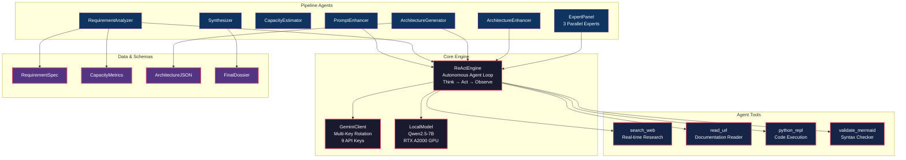
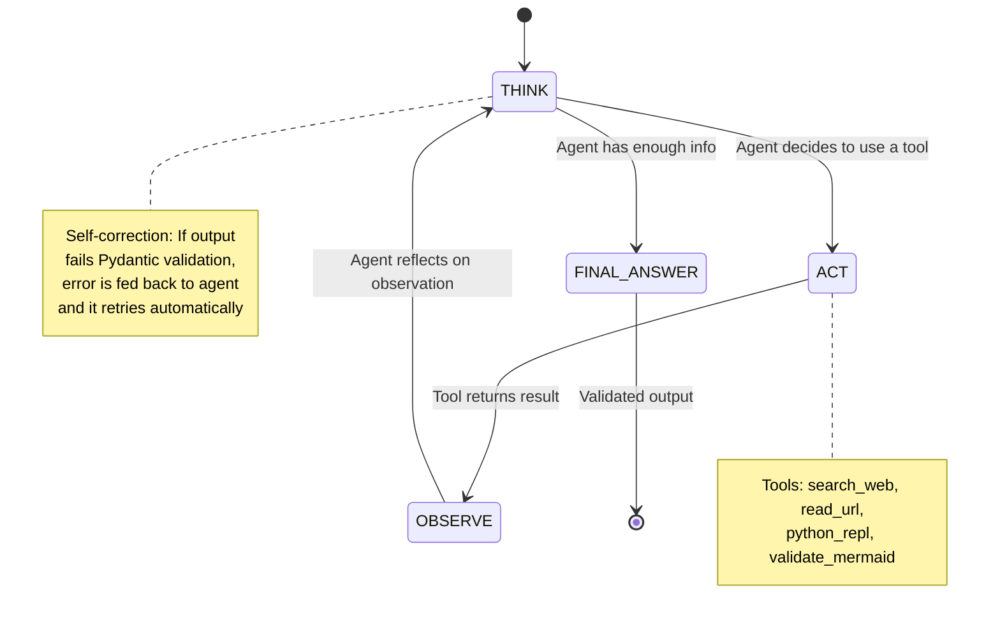
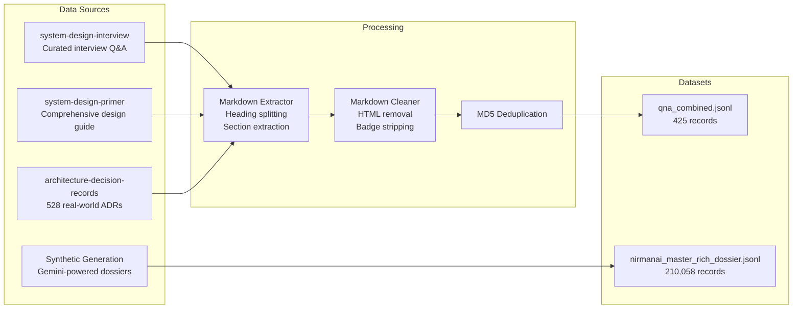

# NirmanAI — Autonomous System Design Architecture Generator

> **An AI-powered multi-agent system that transforms a single natural language prompt into a complete, production-grade distributed system architecture — with capacity planning, Mermaid diagrams, expert-panel review, and actionable deployment blueprints.**

---

## 📌 Problem Statement

### The Challenge

Designing distributed system architectures is one of the most **complex, time-consuming, and expertise-intensive** tasks in software engineering.

| Pain Point | Impact |
|---|---|
| A single system design takes **4–8 hours** for a senior architect | Massive time and cost overhead |
| Requires **cross-domain expertise** — security, databases, SRE, networking | Few engineers possess all skills |
| Capacity planning involves **complex math** — QPS, storage projections, cache sizing | Error-prone manual calculations |
| Architecture diagrams are created **manually** in draw.io / Lucidchart | Inconsistent, hard to maintain |
| Designs lack **formal review** — no built-in security or reliability audit | Blind spots → production failures |
| Junior engineers and startups **cannot afford** senior architect consultations | Knowledge gap widens |

### The Core Question

> *"Can we build an autonomous AI system that takes a single English sentence like 'Design a video streaming platform like Netflix' and produces the same quality output that a team of 3 senior architects would deliver in a week — in under 25 minutes?"*

---

## 💡 Our Solution — NirmanAI

NirmanAI is a **Multi-Agent Agentic AI Pipeline** that autonomously generates production-grade system design architecture dossiers.

### What Makes It Different?

| Feature | Traditional LLM Wrapper | NirmanAI |
|---|---|---|
| Architecture | Single prompt → single response | 6-Phase Multi-Agent Pipeline |
| Research | None — pure hallucination | Live web search for compliance standards |
| Capacity Planning | Vague estimates | Deterministic math engine with exact formulas |
| Diagram Quality | Basic flowchart | Production-grade Mermaid with dark theme, subgraphs, protocols |
| Review Process | None | 3-Expert Panel (Security + DB + SRE) with debate |
| Self-Correction | None | ReAct loop with automatic error recovery |
| Local Model | Cloud-only | Hybrid: Local GPU (Qwen 7B) + Cloud (Gemini) |
| Training Data | Generic | 210,000+ curated system design records |

---

## 🏗️ System Architecture

### High-Level Pipeline Flow

```mermaid
flowchart LR
    subgraph INPUT["User Input"]
        USER["👤 User Prompt<br/>'Design a video streaming platform'"]
    end

    subgraph PHASE0["Phase 0: Prompt Enhancement"]
        PE["🔮 PromptEnhancer Agent<br/>Domain Context Enrichment<br/>Web Research + NLP"]
    end

    subgraph PHASE1["Phase 1: Requirement Analysis"]
        RA["🔍 RequirementAnalyzer Agent<br/>NLP Extraction + Capacity<br/>ReAct Loop + Web Search"]
    end

    subgraph PHASE2["Phase 2: Capacity Estimation"]
        CE["📐 CapacityEstimator<br/>Deterministic Math Engine<br/>QPS, Storage, Cache, Network"]
    end

    subgraph PHASE3["Phase 3: Architecture Generation"]
        LM["🧠 Local GPU Model<br/>Qwen2.5-7B on RTX A2000<br/>Domain Skeleton"]
        AE["✨ ArchitectureEnhancer<br/>Gemini API<br/>Rich Mermaid + JSON"]
    end

    subgraph PHASE4["Phase 4: Expert Panel"]
        SEC["🛡️ Security Expert"]
        DB["💾 Database Expert"]
        SRE["⚙️ SRE Expert"]
        LA["👨‍💼 Lead Architect<br/>Conflict Resolution<br/>Patch Application"]
    end

    subgraph PHASE5["Phase 5: Final Synthesis"]
        SYN["📄 Synthesizer Agent<br/>Markdown + HTML Dossier<br/>Mermaid Dashboard"]
    end

    USER --> PE --> RA --> CE --> LM --> AE --> SEC & DB & SRE --> LA --> SYN

    style INPUT fill:#1a1a2e,color:#fff,stroke:#e94560
    style PHASE0 fill:#16213e,color:#fff,stroke:#0f3460
    style PHASE1 fill:#0f3460,color:#fff,stroke:#533483
    style PHASE2 fill:#162447,color:#fff,stroke:#e94560
    style PHASE3 fill:#1f4068,color:#fff,stroke:#533483
    style PHASE4 fill:#533483,color:#fff,stroke:#e94560
    style PHASE5 fill:#0a0a23,color:#00d2ff,stroke:#1f4068
```



### Detailed Component Diagram



---

## 🛠️ Tech Stack

### Core Technologies

| Layer | Technology | Purpose |
|---|---|---|
| **Language** | Python 3.11 | Core application language |
| **Orchestration** | LangGraph (StateGraph) | Multi-agent workflow orchestration |
| **Cloud LLM** | Google Gemini 3.5 Flash | Primary reasoning engine |
| **Local LLM** | Qwen2.5-7B (4-bit quantized) | Privacy-mode architecture generation |
| **Fine-Tuning** | Unsloth + LoRA + QLoRA | Efficient GPU-based model training |
| **Agent Framework** | Custom ReAct Engine | Autonomous Think → Act → Observe loop |
| **Web Search** | Primp (Rust-based) | Real-time compliance research |
| **Schemas** | Pydantic v2 | Strict type validation for all data |
| **Diagrams** | Mermaid.js | Production-grade architecture visualization |
| **Frontend** | Gradio Web UI + CLI | Dual interface for users |
| **GPU** | NVIDIA RTX A2000 (6GB VRAM) | Local model inference |

### Key Libraries

| Library | Version | Role |
|---|---|---|
| `langchain` / `langgraph` | Latest | DAG-based agent orchestration |
| `google-generativeai` | Latest | Gemini API client |
| `transformers` + `bitsandbytes` | Latest | Local model loading (4-bit) |
| `unsloth` | Latest | 2x faster LoRA fine-tuning |
| `pydantic` | v2.13 | Schema validation |
| `gradio` | Latest | Web UI framework |
| `primp` | Latest | Rust-powered web scraping |

---

## 🔬 How It Works — The 6-Phase Pipeline

### Phase 0: Prompt Enhancement (PromptEnhancer Agent)

**What:** Takes the user's raw prompt and enriches it with domain-specific context.

**How:** The agent uses `search_web` to research the domain (e.g., HIPAA for healthcare, PCI-DSS for payments), then rewrites the prompt with compliance requirements, industry benchmarks, and technical constraints the user may not have mentioned.

**Example:**
```
User Input:  "Design a healthcare records system"
Enhanced:    "Design a HIPAA-compliant, multi-tenant Electronic Health Records system
              with HL7 FHIR API interoperability, end-to-end AES-256 encryption,
              audit logging for 21 CFR Part 11 compliance, and disaster recovery
              with RPO < 1 hour..."
```

---

### Phase 1: Requirement Analysis (RequirementAnalyzer Agent)

**What:** Extracts structured requirements from the enhanced prompt using NLP.

**How:** A ReAct agent with web search capabilities:
1. **Searches** for domain-specific compliance standards
2. **Extracts** functional requirements (4–6)
3. **Extracts** non-functional requirements / SLAs (3–5)
4. **Estimates** DAU, QPS, storage projections
5. **Self-validates** output against sanity checks

**Output:** `RequirementSpec` + `CapacityMetrics` (Pydantic-validated)

---

### Phase 2: Capacity Estimation (Deterministic Math Engine)

**What:** Replaces LLM guesswork with **exact mathematical formulas**.

**How:** Pure Python math — no LLM involved:
```
Average QPS  = (DAU × 30 requests/day) / 86,400 seconds
Peak QPS     = Average QPS × Peak Factor (typically 3x)
Read QPS     = Peak QPS × Read Ratio (e.g., 80%)
Write QPS    = Peak QPS × Write Ratio (e.g., 20%)
5yr Storage  = Daily Growth × 365 × 5 × Replication Factor (3x)
Cache RAM    = Hot Working Set (20% of daily data) × Safety Margin
```

**Why:** LLMs hallucinate numbers. Deterministic math does not.

---

### Phase 3: Architecture Generation (Hybrid GPU + Cloud)

**What:** Generates the full system architecture topology + Mermaid diagram.

**How — Two-Stage Draft → Refine:**
1. **Phase 3a (Local GPU):** The fine-tuned Qwen2.5-7B model runs on the RTX A2000 and generates a raw domain-specific architecture skeleton in ~3 minutes
2. **Phase 3b (Gemini Cloud):** The ArchitectureEnhancer agent takes the raw skeleton and enriches it with production-grade Mermaid code, including dark theme styling, `<br/>` protocol labels, and nested subgraphs

**Mermaid Rules (DRY — Shared via `prompts.py`):**
- Dark theme `classDef` colors enforced
- All node labels must use `<br/>` tags inside double quotes
- Every edge must show the protocol (gRPC, HTTPS, TCP, etc.)
- Minimum 5 subgraphs required

---

### Phase 4: Expert Panel (Multi-Agent Debate)

**What:** Three independent AI experts simultaneously critique the architecture.

**How:**
| Expert | Focus Area | Example Finding |
|---|---|---|
| 🛡️ **Security Lead** | Encryption, auth, compliance | "Missing WAF in front of API Gateway" |
| 💾 **Database Engineer** | Data modeling, replication, sharding | "Aurora can't handle 50M docs — use DynamoDB" |
| ⚙️ **SRE Lead** | Fault tolerance, multi-AZ, DR | "No circuit breaker between services" |

After all 3 experts finish, the **Lead Architect** agent:
1. Reads all critiques
2. Resolves conflicts
3. Applies patches to the architecture JSON
4. Regenerates the Mermaid diagram with strict styling rules

**Scoring:** Expert Panel score (avg of 3 experts) + Critic audit score → must exceed threshold to pass.

---

### Phase 5: Final Synthesis (Synthesizer Agent)

**What:** Compiles everything into a polished, presentable output.

**Output Files:**
- **Markdown Dossier** (`.md`) — Full architecture document with embedded Mermaid
- **HTML Dashboard** (`.html`) — Standalone, browser-viewable architecture page

**Contents:**
- System Overview
- Capacity Planning Table
- Architecture Mermaid Diagram (Topology)
- Sequence Diagram (Request Flow)
- Component Breakdown with Technology Rationale
- Trade-off Analysis
- Bottleneck Identification & Mitigation

---

## 🧠 The ReAct Engine — Core Innovation

The heart of NirmanAI is our custom **ReAct (Reason + Act) Engine** that powers every agent.



### Key Features:
- **Autonomous Decision Making:** The agent decides its own next action
- **Self-Correction:** If Pydantic validation fails, the error message is injected back and the agent retries
- **Tool Usage:** Agents can search the web, read URLs, execute Python, and validate Mermaid syntax
- **Multi-Key API Rotation:** 9 Gemini API keys with automatic rotation on HTTP 429

---

## 📊 Training & Fine-Tuning

### Dataset Curation Pipeline



### Dataset Statistics

| Dataset | Records | Source |
|---|---|---|
| `nirmanai_master_rich_dossier.jsonl` | **210,058** | Synthetically generated architecture dossiers |
| `qna_combined.jsonl` | **425** | Curated from 3 open-source repositories |
| **Total Training Data** | **210,483** | Combined |

### Fine-Tuning Configuration

| Parameter | Value |
|---|---|
| Base Model | `Qwen2.5-7B-Instruct` |
| Quantization | 4-bit (BnB NF4) |
| Method | QLoRA (Low-Rank Adaptation) |
| LoRA Rank | 16 |
| LoRA Alpha | 32 |
| Learning Rate | 2e-4 |
| Epochs | 3 |
| GPU | NVIDIA RTX A2000 (6GB VRAM) |
| Training Time | ~4 hours |
| Framework | Unsloth (2x faster than standard HF) |

---

## 📁 Project Structure

```
NirmanAI/
├── nirman/                          # Core application package
│   ├── agents/
│   │   ├── core/                    # Shared infrastructure
│   │   │   ├── react_engine.py      # 🧠 ReAct autonomous agent loop
│   │   │   ├── gemini_client.py     # Gemini API with multi-key rotation
│   │   │   ├── local_model.py       # Local GPU model (Qwen 7B)
│   │   │   └── orchestrator.py      # Agent coordination
│   │   ├── pipeline/                # The 6-phase pipeline agents
│   │   │   ├── enhancer.py          # Phase 0: Prompt Enhancement
│   │   │   ├── analyzer.py          # Phase 1: Requirement Analysis
│   │   │   ├── estimator.py         # Phase 2: Capacity Math Engine
│   │   │   ├── generator.py         # Phase 3a: Local Architecture Gen
│   │   │   ├── architecture_enhancer.py  # Phase 3b: Cloud Enhancement
│   │   │   ├── expert_panel.py      # Phase 4: Multi-Expert Review
│   │   │   └── synthesizer.py       # Phase 5: Final Output
│   │   └── legacy/                  # Deprecated single-shot agents
│   ├── interfaces/
│   │   ├── cli.py                   # Command-line interface
│   │   └── web_ui.py                # Gradio web dashboard
│   ├── schemas/                     # Pydantic data models
│   │   ├── pipeline/                # Pipeline-specific schemas
│   │   └── legacy/                  # Deprecated schemas
│   ├── tools/                       # Agent tool implementations
│   │   ├── research/                # search_web, read_url
│   │   ├── execution/               # python_repl
│   │   └── validation/              # validate_mermaid
│   ├── workflow/
│   │   ├── graph.py                 # LangGraph StateGraph definition
│   │   └── state.py                 # Shared pipeline state
│   └── prompts.py                   # DRY shared Mermaid rules
├── datasets/                        # Training data (gitignored)
├── models/                          # Fine-tuned model checkpoints
├── training/                        # Training scripts & evaluation
├── scripts/                         # Dataset curation & utilities
├── tests/e2e/                       # End-to-end pipeline tests
├── output/                          # Generated architecture outputs
└── docs/                            # Documentation
```

---

## ✅ Results & Benchmarks

### End-to-End Pipeline Test Results

| Metric | Value |
|---|---|
| **Test Prompt** | "Design an AI/ML Inference & Data Science Platform" |
| **Total Pipeline Runtime** | 25 minutes |
| **Phases Completed** | 6/6 (all passed) |
| **Expert Panel Score** | 86/100 |
| **Critic Audit Score** | 93.2/100 |
| **Patches Applied** | 10 architectural improvements |
| **Components Generated** | 13 services |
| **Connections Mapped** | 14 inter-service links |
| **Trade-offs Documented** | 4 architectural decisions |
| **Single Point of Failure** | None detected ✅ |

### Sample Output Quality

The system generates complete architecture dossiers containing:
- ✅ Production-grade Mermaid topology diagrams with dark theme
- ✅ Sequence diagrams showing request flow with protocols
- ✅ Exact capacity numbers (QPS, storage, cache, bandwidth)
- ✅ Component-by-component technology rationale
- ✅ Security audit findings with remediations
- ✅ Bottleneck analysis with specific mitigation strategies

---

## 🔮 Future Plans & Roadmap

### Phase 1: Interactive Architecture Copilot
- **Conversational Refinement:** Users can ask follow-up questions like *"Replace PostgreSQL with DynamoDB"* or *"Add a message queue between Service A and B"*
- The pipeline will **incrementally patch** the architecture instead of regenerating from scratch
- Real-time Q&A about any component: *"Why did you choose Redis over Memcached?"*

### Phase 2: Real-Time Streaming Dashboard
- Live WebSocket-based UI showing each agent's reasoning in real-time
- Watch the Security Expert and Database Expert debating architecture decisions live
- Progress bar with phase indicators and live log streaming

### Phase 3: Infrastructure-as-Code Generation
- Automatic **Terraform / AWS CloudFormation / Pulumi** code generation
- One-click deployment from architecture diagram to actual cloud infrastructure
- Cost estimation integrated into capacity planning

### Phase 4: Multi-Cloud & Edge Support
- Generate architectures that span multiple cloud providers (AWS + GCP hybrid)
- Edge computing topology generation for IoT and CDN-heavy workloads
- Kubernetes manifest generation (Helm charts, Kustomize)

### Phase 5: Team Collaboration Features
- Multi-user architecture editing with conflict resolution
- Version control for architectures (diff between v1 and v2)
- Export to Confluence, Notion, Google Docs

### Phase 6: Full Privacy Mode
- **100% local execution** — no data leaves the user's machine
- Upgraded local model to handle all phases without Gemini
- HIPAA / SOC2 compliant deployment option for enterprises

---

## 👥 Team

| Role | Contribution |
|---|---|
| **AI/ML Engineer** | Fine-tuning pipeline, dataset curation, model training |
| **Backend Engineer** | Multi-agent architecture, ReAct engine, LangGraph orchestration |
| **Systems Architect** | Prompt engineering, expert panel design, Mermaid styling |

---

## 🏆 Key Achievements

1. **210,000+ training records** curated and synthetically generated
2. **Custom ReAct Engine** with self-correction and web research capabilities
3. **Hybrid Local + Cloud** architecture — works with or without internet
4. **3-Expert Panel** that autonomously debates and patches architectures
5. **Deterministic Math Engine** replacing LLM hallucination for capacity planning
6. **Production-grade Mermaid** output with dark theme, protocols, and subgraphs
7. **DRY Prompt Architecture** — shared styling rules across all agents
8. **93.2/100 Critic Score** on autonomous end-to-end pipeline test
9. **9-key API rotation** for resilient Gemini API usage under rate limits
10. **25-minute end-to-end** generation time for a complete architecture dossier

---

## 📎 Links & References

| Resource | Link |
|---|---|
| **GitHub Repository** | [SyncWithRaj/PDS](https://github.com/SyncWithRaj/PDS) |
| **Sample Output (HTML)** | `output/e2e_agentic_test/*.html` |
| **Sample Output (Markdown)** | `output/e2e_agentic_test/*.md` |
| **Training Dataset** | `datasets/nirmanai_master_rich_dossier.jsonl` |
| **QnA Dataset** | `datasets/qna_combined.jsonl` |

---

> *"NirmanAI doesn't just generate architectures — it debates them, critiques them, patches them, and delivers them production-ready."*
