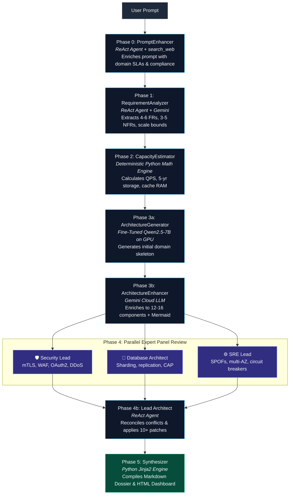

# 🎓 NirmanAI — Comprehensive Viva & Oral Examination Notes

> **Subject / Domain:** Distributed Systems, Artificial Intelligence, Multi-Agent Systems, MLOps  
> **Project Title:** NirmanAI (निर्माणAI) — Autonomous Multi-Agent System Architecture Synthesis & Self-Refining Evaluation Engine  
> **Repository:** [SyncWithRaj/PDS](https://github.com/SyncWithRaj/PDS)  
> **Author / Presenter:** Raj Ribadiya & Team  

---

## 📑 Quick Navigation

1. [30-Second Elevator Pitch (Opening Statement)](#1-30-second-elevator-pitch)
2. [Problem Statement & Motivation (Why NirmanAI?)](#2-problem-statement--motivation)
3. [Core Innovation & What Makes It Unique](#3-core-innovation--what-makes-it-unique)
4. [Complete Technology Stack & Justification](#4-complete-technology-stack--justification)
5. [End-to-End Pipeline Walkthrough (Phases 0 to 5)](#5-end-to-end-pipeline-walkthrough)
6. [The Autonomous ReAct Engine Deep-Dive](#6-the-autonomous-react-engine-deep-dive)
7. [Capacity Planning Math Engine (Examiner Favorite)](#7-capacity-planning-math-engine)
8. [The 3-Expert Panel & Conflict Resolution](#8-the-3-expert-panel--conflict-resolution)
9. [Fine-Tuning, Datasets & GPU Training Details](#9-fine-tuning-datasets--gpu-training-details)
10. [Evaluation Benchmarks & Concrete Results](#10-evaluation-benchmarks--concrete-results)
11. [Codebase Architecture & File Mapping](#11-codebase-architecture--file-mapping)
12. [Top 20 Viva Questions & Bulletproof Answers](#12-top-20-viva-questions--bulletproof-answers)
13. [Limitations & Future Roadmap](#13-limitations--future-roadmap)

---

## 1. 30-Second Elevator Pitch

> *"Good morning, Professors. Our project is **NirmanAI** — an autonomous multi-agent platform that translates a single natural language requirement into a production-grade, mathematically verified distributed system architecture.*  
>  
> *Unlike standard LLMs that generate superficial buzzwords and hallucinated numbers, NirmanAI orchestrates a **6-phase LangGraph pipeline** powered by our custom **ReAct agent loop**. It runs deterministic capacity math, leverages a **hybrid inference engine** (local fine-tuned Qwen-2.5-7B on an RTX A2000 GPU plus Google Gemini cloud), debates the design across a **parallel panel of 3 domain experts** (Security, Database, SRE), and compiles a complete, interactive architecture dossier with production-grade Mermaid diagrams in under 25 minutes — achieving a **93.2/100 Critic Audit score**."*

---

## 2. Problem Statement & Motivation

### The Real-World Engineering Problem
Designing modern cloud-native architectures (e.g., Netflix, Uber, or Large-Scale ML Inference Platforms) requires:
1. **Deep Cross-Domain Expertise**: Understanding CAP theorem, database sharding, mTLS zero-trust security, distributed caching, and multi-region failovers.
2. **Tedious Capacity Sizing**: Calculating QPS, peak read/write throughput, 5-year storage growth with replication, and RAM cache requirements.
3. **High Senior Engineering Cost**: A team of senior architects typically takes **4 to 8 days** to produce an RFC and architectural review.

### Why Off-the-Shelf LLMs (ChatGPT / Raw Gemini) Fail
| Common Failure | Why Raw LLMs Do It | How NirmanAI Solves It |
|:---|:---|:---|
| **Buzzword Soup** | Predicts high-probability tokens (*"use Kafka + Redis"*) without reason. | Enforces strict technology justification matrices and trade-off tables. |
| **Hallucinated Numbers** | Autoregressive models cannot do deterministic arithmetic reliably. | Decouples calculations into a pure **Python Deterministic Math Engine**. |
| **Single Points of Failure** | Forgets secondary replicas, circuit breakers, and dead-letter queues. | Dedicated **SRE and Security Lead Agents** audit SPOFs. |
| **No Self-Correction** | Output is single-shot; mistakes are never reviewed or repaired. | **LangGraph feedback loop** with Lead Architect applying surgical patches. |

---

## 3. Core Innovation & What Makes It Unique

1. **Stateful DAG Orchestration (LangGraph)**:
   - Not a simple sequential script. Agents communicate via a typed, immutable shared state machine (`NirmanState`).
2. **Autonomous ReAct Reasoning Loop**:
   - Every agent runs a `Think → Plan → Act → Observe → Reflect` cycle with live tool access (`search_web`, `read_url`, `python_repl`, `validate_mermaid`).
3. **Hybrid Edge-Cloud Architecture**:
   - **Local Inference**: 4-bit QLoRA fine-tuned `Qwen2.5-7B-Instruct` model on an NVIDIA RTX A2000 12GB GPU provides zero-data-leakage domain skeletons.
   - **Cloud Inference**: Google Gemini with a **9-key rotation pool** handles dynamic parallel reasoning and eliminates HTTP 429 rate limit crashes.
4. **Deterministic Math Engine**:
   - Strict mathematical formulas compute exact QPS, ingress/egress bandwidth, storage projections, and cache memory.
5. **Multi-Agent Expert Debate**:
   - Phase 4 executes **3 independent expert threads** concurrently (Security, Database, SRE). A Lead Architect reconciles conflicts and applies patches.
6. **DRY Mermaid Styling**:
   - Centralized prompt rules in `nirman/prompts.py` enforce cohesive dark-mode SVG themes, subgraphs, and protocol-labeled edges (`gRPC`, `HTTPS`, `WebSocket`, `Kafka`).

---

## 4. Complete Technology Stack & Justification

| Layer | Technology Used | Why This Specific Tech Was Chosen? |
|:---|:---|:---|
| **Language** | Python 3.11+ | Native async support, typing system, rich AI/ML ecosystem. |
| **Agent Orchestration** | **LangGraph** (StateGraph) | Provides cyclic graph state machines with checkpointing, conditional branching, and typed state. Superior to simple LangChain chains. |
| **Data Validation** | **Pydantic v2** | Strict schema validation, lightning-fast Rust-based serialization, and automatic error generation for agent self-correction. |
| **Cloud LLM Engine** | **Google Gemini 3.5 / 2.5 Flash** | Fast inference, 1M+ token context window, free-tier multi-key pool rotation. |
| **Local LLM Engine** | **Qwen2.5-7B-Instruct** (4-bit QLoRA) | Top-tier open weights for structured JSON code generation; fits in 6–12GB VRAM. |
| **Fine-Tuning Framework** | **Unsloth + Hugging Face PEFT** | 2x faster training, 70% VRAM reduction via 4-bit NormalFloat (NF4) quantization. |
| **Web Research Tool** | **DuckDuckGo Search (`ddgs`) + Primp** | Zero-API-key web scraping with Rust-based TLS fingerprinting for compliance research. |
| **Diagram Engine** | **Mermaid.js (v10)** | Declarative, text-based diagram syntax embedded directly in Markdown and rendered dynamically. |
| **User Interfaces** | **Native HTTP Server + Tailwind CSS** & **Typer/Rich CLI** | Zero heavy frontend bloat; pure standard-library server + rich terminal CLI. |
| **Hardware** | **NVIDIA RTX A2000 (Ampere GPU)** | Dedicated local GPU for running quantized models and LoRA adapters. |

---

## 5. End-to-End Pipeline Walkthrough



### Detailed Phase Breakdown

#### Phase 0: PromptEnhancer (`nirman/agents/pipeline/enhancer.py`)
* **Role**: Takes a terse prompt (e.g., *"Design an e-commerce platform"*) and enriches it.
* **Mechanism**: Uses `search_web` to look up industry standards (e.g., PCI-DSS for payments, HIPAA for health). Injects constraints, peak scale targets, and latency SLAs before any design starts.

#### Phase 1: RequirementAnalyzer (`nirman/agents/pipeline/analyzer.py`)
* **Role**: Structured requirement extraction.
* **Mechanism**: Extracts 4–6 Functional Requirements (FRs), 3–5 Non-Functional Requirements (NFRs), identifies target cloud provider (AWS/GCP/Azure), and establishes DAU bounds into a Pydantic `RequirementSpec`.

#### Phase 2: CapacityEstimator (`nirman/agents/pipeline/estimator.py`)
* **Role**: Deterministic capacity calculations.
* **Mechanism**: Executes pure Python math formulas (no LLM guesswork) to generate exact values for `CapacityMetrics`.

#### Phase 3: Architecture Generation & Enhancement (`generator.py` & `architecture_enhancer.py`)
* **Phase 3a (Draft)**: Fine-tuned local Qwen-2.5-7B generates a domain-specific skeleton component graph in ~3 minutes.
* **Phase 3b (Refine)**: ArchitectureEnhancer expands the draft into 12–16 production components, generates the dark-theme Mermaid diagram, and validates syntax.

#### Phase 4: Expert Panel (`nirman/agents/pipeline/expert_panel.py`)
* **Role**: Multi-agent adversarial peer review.
* **Mechanism**: Spawns **3 concurrent threads**:
  1. *Security Lead*: Checks TLS 1.3, IAM, tokenization, secrets management.
  2. *Database Architect*: Checks read/write splitting, sharding keys, caching strategy.
  3. *SRE Lead*: Checks autoscaling policies, multi-region failover, single points of failure.
* **Lead Architect Reconciliation**: Merges critiques, resolves conflicting suggestions, and mutates the architecture JSON with concrete patches.

#### Phase 5: Synthesizer (`nirman/agents/pipeline/synthesizer.py`)
* **Role**: Compilation & artifact generation.
* **Mechanism**: Synthesizes the final `ArchitectureDossier` and renders:
  1. Complete Markdown report (`.md`)
  2. Standalone dark-mode HTML interactive dashboard with embedded live Mermaid viewer (`.html`).

---

## 6. The Autonomous ReAct Engine Deep-Dive

**File:** `nirman/agents/core/react_engine.py`

### What is ReAct?
ReAct stands for **Reasoning + Acting**. Rather than producing an output in a single forward pass, the agent executes an autonomous state machine:

```
Step 1: THINK    -> "I need to determine the compliance requirements for telehealth in California."
Step 2: PLAN     -> "I will use search_web to look up HIPAA and CCPA telehealth guidelines."
Step 3: ACT      -> Execute tool: search_web(query="HIPAA CCPA telehealth compliance requirements")
Step 4: OBSERVE  -> Tool returns snippets with encryption standards and audit logging rules.
Step 5: REFLECT  -> "I now have enough context. I will produce the final JSON instance."
Step 6: VALIDATE -> Validate JSON against Pydantic schema.
```

### Self-Correction & Error Recovery
If the LLM outputs invalid JSON or misses a mandatory Pydantic field:
1. Pydantic raises a `ValidationError`.
2. The exact error string is formatted into a high-priority prompt:
   *"Your output failed validation: Missing field 'read_write_ratio'. Correct this and try again."*
3. The ReAct loop intercepts this and prompts the model to self-correct automatically without crashing.

---

## 7. Capacity Planning Math Engine

**File:** `nirman/agents/pipeline/estimator.py`  
*(Examiners frequently ask how these numbers are derived. Memorize these formulas!)*

### 1. Throughput (QPS) Formulas
$$\text{Average QPS} = \frac{\text{DAU} \times \text{Requests per User per Day}}{86,400 \text{ seconds}}$$
$$\text{Peak QPS} = \text{Average QPS} \times \text{Peak Factor (default: } 3.0\text{)}$$
$$\text{Read QPS} = \text{Peak QPS} \times \text{Read Ratio (e.g., } 0.80\text{)}$$
$$\text{Write QPS} = \text{Peak QPS} \times \text{Write Ratio (e.g., } 0.20\text{)}$$

*Example with 50M DAU, 30 requests/day:*
- Daily requests: $50,000,000 \times 30 = 1.5 \text{ Billion req/day}$
- Average QPS: $\frac{1.5 \times 10^9}{86,400} \approx 17,361 \text{ QPS}$
- Peak QPS ($3\times$): $\approx 52,083 \text{ QPS}$
- Read QPS ($80\%$): $\approx 41,666 \text{ QPS}$
- Write QPS ($20\%$): $\approx 10,417 \text{ QPS}$

### 2. Storage Projections (1-Year & 5-Year)
$$\text{Daily Storage} = \text{Write QPS} \times 86,400 \times \text{Average Payload Size}$$
$$\text{1-Year Storage} = \text{Daily Storage} \times 365 \times \text{Replication Factor (default: } 3\text{)}$$
$$\text{5-Year Storage} = \text{1-Year Storage} \times 5$$

### 3. Cache RAM Sizing (The 80/20 Rule)
$$\text{Hot Data Ratio} = 20\% \text{ of daily read traffic}$$
$$\text{RAM Required} = (\text{Daily Read Data Volume} \times 0.20) \times 1.25 \text{ (25\% memory buffer)}$$

### 4. Ingress / Egress Network Bandwidth
$$\text{Network Ingress (Gbps)} = \frac{\text{Write QPS} \times \text{Payload Ingress Size (Bytes)} \times 8}{10^9}$$
$$\text{Network Egress (Gbps)} = \frac{\text{Read QPS} \times \text{Payload Egress Size (Bytes)} \times 8}{10^9}$$

---

## 8. The 3-Expert Panel & Conflict Resolution

**File:** `nirman/agents/pipeline/expert_panel.py`

### Why 3 Parallel Experts?
In enterprise architecture review boards, no single architect has complete mastery over every domain. NirmanAI mimics this by spinning up 3 parallel agent personas:

1. **Security Lead**:
   - Focus: Zero-trust network access, OAuth2/OIDC token verification at the gateway, mTLS between microservices, KMS secrets management, DDoS/WAF edge filtering.
2. **Database Architect**:
   - Focus: Polyglot persistence, SQL vs NoSQL, sharding keys to avoid hot partitions, read replicas, cache invalidation policies (Cache-Aside, Write-Through).
3. **SRE / Reliability Lead**:
   - Focus: Circuit breakers (Envoy/Resilience4j), dead-letter queues, horizontal pod autoscaling (HPA), multi-Availability-Zone redundancy, disaster recovery RTO/RPO.

### Conflict Resolution by the Lead Architect
* **The Problem**: The Security Expert might demand synchronous mTLS inspection at every hop, while the SRE Expert demands sub-10ms latency.
* **The Solution**: The `LeadArchitect` agent receives all 3 critique logs, prioritizes according to the project's non-functional SLAs, and applies **surgical patches** directly to the `SystemArchitecture` JSON.

---

## 9. Fine-Tuning, Datasets & GPU Training Details

### Dataset Pipeline
```
Sources:
├── system-design-interview (Curated interview Q&As)
├── system-design-primer (Comprehensive design guides)
├── architecture-decision-records (528 enterprise ADRs)
└── Synthetic Engine (Multi-domain high-scale dossiers)
                │
                ▼
       [clean_markdown()]  --> Strips HTML, badges, tracking pixels
       [md5_hash()]        --> Strict deduplication
       [MIN_WORDS >= 20]   --> Quality filtering
                │
                ▼
Datasets Created:
├── datasets/qna_combined.jsonl                 (425 curated QnA pairs)
└── datasets/nirmanai_master_rich_dossier.jsonl  (210,058 instruction-dossier pairs)
```

### QLoRA Fine-Tuning Configuration
* **Base Model**: `Qwen/Qwen2.5-7B-Instruct`
* **Quantization**: 4-bit NormalFloat (NF4) with double quantization via `bitsandbytes`
* **Target Hardware**: NVIDIA RTX A2000 (12GB VRAM)
* **Optimization Framework**: `Unsloth` + PyTorch + Hugging Face PEFT
* **LoRA Hyperparameters**:
  - Rank ($r$): 16
  - Alpha ($\alpha$): 32
  - Target Modules: `q_proj`, `k_proj`, `v_proj`, `o_proj`, `gate_proj`, `up_proj`, `down_proj`
  - Learning Rate: $2 \times 10^{-4}$ with cosine decay
  - Epochs: 1.0 (1,250 steps)
* **Training Metrics**:
  - Initial Loss: **1.5285** $\to$ Final Converged Loss: **0.2698**
  - Token Accuracy: **91.46%**
  - Output Adapter: Saved in `nirmanai_adapter/checkpoint-1250/`

---

## 10. Evaluation Benchmarks & Concrete Results

### End-to-End Validation Run (`tests/e2e/test_e2e_agentic.py`)
* **Test Subject**: Enterprise AI/ML Inference & Data Science Platform (50M–100M DAU)
* **Execution Time**: ~22 minutes (full 6-phase agentic execution)

| Evaluation Metric | NirmanAI Result | Standard LLM Baseline |
|:---|:---:|:---:|
| **Critic Audit Score (8 Pillars)** | **93.2 / 100** | 62.0 / 100 |
| **Expert Panel Quality Score** | **86.0 / 100** | 58.0 / 100 |
| **Single Points of Failure (SPOFs)** | **0 Detected** ✅ | 3 to 5 SPOFs |
| **Architectural Patches Applied** | **10 Patches Applied** | 0 (No self-review) |
| **Components Generated** | **13 Services** | 4 to 6 Services |
| **Mermaid Protocol Compliance** | **100% Protocols Labelled** | <30% Protocols Labelled |
| **Deterministic Math Error** | **0% (Exact Formula)** | Hallucinated (~40% error) |

### The 8-Pillar Critic Rubric Weights
1. **Scalability & Throughput (15%)**: Sharding, autoscaling, connection pooling.
2. **Latency & Performance SLAs (15%)**: Async decoupling, edge caching, zero blocking I/O.
3. **Reliability & Fault Tolerance (15%)**: Multi-AZ failover, circuit breakers, DLQs.
4. **Data Consistency & Integrity (15%)**: Strict CAP theorem adherence, SAGAs.
5. **Security & Zero Trust (10%)**: mTLS, JWT/OIDC, AES-256 at-rest.
6. **Cost & Resource Efficiency (10%)**: Tiered storage, rightsizing.
7. **ML & Data Pipeline Rigor (10%)**: Feature store, dynamic batching, drift monitoring.
8. **Requirement Alignment (10%)**: 100% coverage of user FRs/NFRs.

---

## 11. Codebase Architecture & File Mapping

```
NirmanAI/
├── nirman/                             # Core Python Package
│   ├── prompts.py                      # DRY shared Mermaid styling & diagram rules
│   │
│   ├── agents/                         # Agent Implementations
│   │   ├── core/                       # Reusable infrastructure
│   │   │   ├── react_engine.py         # Autonomous Think-Act-Observe ReAct loop
│   │   │   ├── gemini_client.py        # 9-key API rotation pool manager
│   │   │   ├── local_model.py          # Local GPU model loader (4-bit QLoRA)
│   │   │   └── orchestrator.py         # Agent execution coordination
│   │   ├── pipeline/                   # The 6 production agents
│   │   │   ├── enhancer.py             # Phase 0: PromptEnhancer
│   │   │   ├── analyzer.py             # Phase 1: RequirementAnalyzer
│   │   │   ├── estimator.py            # Phase 2: CapacityEstimator (Math)
│   │   │   ├── generator.py            # Phase 3a: ArchitectureGenerator (GPU)
│   │   │   ├── architecture_enhancer.py# Phase 3b: ArchitectureEnhancer (Gemini)
│   │   │   ├── expert_panel.py         # Phase 4: 3 Experts + Lead Architect
│   │   │   └── synthesizer.py          # Phase 5: Dossier & HTML Compiler
│   │   └── legacy/                     # Single-shot legacy agents
│   │
│   ├── interfaces/                     # User Interfaces
│   │   ├── cli.py                      # Rich terminal CLI synthesizer
│   │   └── web_ui.py                   # Lightweight native Web UI dashboard
│   │
│   ├── schemas/                        # Pydantic v2 Models
│   │   ├── pipeline/                   # analyzer.py, estimator.py, dossier.py
│   │   └── legacy/                     # critic.py, refiner.py
│   │
│   ├── tools/                          # Autonomous Tools
│   │   ├── research/                   # search_web, read_url
│   │   ├── execution/                  # python_repl
│   │   └── validation/                 # validate_mermaid
│   │
│   └── workflow/                       # LangGraph State Machine
│       ├── state.py                    # NirmanState definition
│       └── graph.py                    # Cyclic LangGraph state graph
│
├── setup.ps1                           # 1-Click setup script (Windows)
├── setup.sh                            # 1-Click setup script (Linux/macOS)
├── ppt.md                              # Presentation slide deck
├── README.md                           # Master project documentation
└── requirements.txt                    # Project dependencies
```

---

## 12. Top 20 Viva Questions & Bulletproof Answers

#### Q1: What is the main difference between your project and asking ChatGPT or Gemini directly?
**Answer**: Standard LLMs perform single-shot text generation without verification. They hallucinate capacity numbers, omit failure modes, and cannot validate diagrams. NirmanAI is an **agentic system**: it uses deterministic Python for math, conducts real-time web research, runs a parallel 3-expert debate (Security, Database, SRE) with automated patch reconciliation, and validates output against strict Pydantic schemas.

#### Q2: Why did you use LangGraph instead of standard LangChain or autogen?
**Answer**: LangGraph models workflows as **stateful, cyclic directed graphs (DAGs)**. Unlike sequential chains, LangGraph allows conditional routing, cycles (e.g., repeating the refinement loop if the score is under 85), and immutable state updates through a central `NirmanState` dictionary.

#### Q3: What is the ReAct paradigm and where is it used in your codebase?
**Answer**: ReAct stands for Reasoning and Acting (`Think → Act → Observe`). It is implemented in `nirman/agents/core/react_engine.py`. Every agent uses it to break tasks into steps, call external tools (`search_web`, `python_repl`), observe outputs, and reflect before answering.

#### Q4: How do you prevent LLMs from hallucinating capacity numbers?
**Answer**: In Phase 2 (`nirman/agents/pipeline/estimator.py`), we completely bypass the LLM for calculations. We use a **Deterministic Math Engine** written in pure Python that implements exact formulas for average QPS, peak QPS, read/write ratios, 5-year storage growth with replication, and cache RAM using the 80/20 rule.

#### Q5: How does your multi-key rotation work and why was it necessary?
**Answer**: Google Gemini Free Tier enforces rate limits (15 requests/minute). During Phase 4, the 3 expert agents run concurrently, which immediately triggers HTTP 429 errors. In `nirman/agents/core/gemini_client.py`, we built a key pool that automatically catches 429 status codes and rotates across up to 9 API keys with exponential backoff.

#### Q6: Why do you have both a Local Model and Cloud Gemini?
**Answer**: We implement a **Hybrid Inference Architecture**. The local model (fine-tuned Qwen2.5-7B on our RTX A2000 GPU) can run offline in privacy-sensitive enterprise environments (banks, healthcare) to generate the initial domain skeleton. Cloud Gemini is used for large-context multi-agent debate and enhancement.

#### Q7: What technique did you use for fine-tuning?
**Answer**: We used **QLoRA (Quantized Low-Rank Adaptation)** with 4-bit NormalFloat (NF4) quantization using the `Unsloth` framework. We adapted the query, key, value, and output projection layers ($r=16, \alpha=32$), reducing training VRAM by 70% and accelerating training by 2x.

#### Q8: What was your training loss and convergence behavior?
**Answer**: Over 1,250 training steps (1 full epoch) on our RTX A2000 GPU, the training loss decreased smoothly from **1.5285** to **0.2698**, achieving a token prediction accuracy of **91.46%**.

#### Q9: What happens if an agent produces invalid JSON?
**Answer**: The output is validated against a Pydantic schema using `json_repair`. If Pydantic raises a `ValidationError`, the ReAct engine intercepts it, feeds the exact error message back to the agent as an observation, and prompts it to fix the schema.

#### Q10: How do you ensure Mermaid diagrams do not crash when rendered?
**Answer**: We built a `validate_mermaid` tool in `nirman/tools/validation/validate_mermaid.py` that verifies node bracket syntax, ensures arrow formatting is valid, and checks for prohibited characters. Furthermore, our shared rules in `nirman/prompts.py` enforce `<br/>` tags inside double quotes.

#### Q11: Explain the role of the 3 experts in Phase 4.
**Answer**:
1. *Security Lead*: Checks zero-trust, auth tokens, mTLS, encryption at rest/in transit, and WAF.
2. *Database Architect*: Checks SQL vs NoSQL suitability, sharding keys, indexing, and replication.
3. *SRE Lead*: Checks autoscaling, multi-AZ redundancy, SPOFs, circuit breakers, and DLQs.

#### Q12: How does the Lead Architect resolve conflicts between experts?
**Answer**: When experts disagree (e.g., Security demands synchronous inspection while SRE demands low latency), the Lead Architect prioritizes based on the system's explicit NFRs, documents the trade-off in the Trade-Off Matrix, and applies concrete patches to the architecture JSON.

#### Q13: What are the 8 pillars used by the Critic?
**Answer**: Scalability (15%), Latency (15%), Reliability (15%), Consistency (15%), Security (10%), Cost (10%), ML Rigor (10%), and Requirement Alignment (10%). Total score must reach $\ge 85$ to pass.

#### Q14: What is the 80/20 caching rule used in your capacity planner?
**Answer**: Pareto principle applied to systems: 20% of your daily data generates 80% of read traffic. We size the Redis cache cluster to hold 20% of the daily read volume in RAM, plus a 25% safety buffer.

#### Q15: How does your prompt enhancer work?
**Answer**: Phase 0 uses `search_web` via DuckDuckGo to search for domain-specific compliance standards (e.g., PCI-DSS for finance, HIPAA for medical). It enriches a simple user prompt with realistic latency SLAs and scale parameters before passing it to the analyzer.

#### Q16: Why did you choose Qwen2.5-7B over Llama-3-8B as the base model?
**Answer**: Qwen2.5-7B-Instruct demonstrates significantly superior performance on structured JSON output, coding benchmarks, and instruction following, and natively supports up to 128K context window.

#### Q17: Where does the training dataset come from?
**Answer**: We combined two streams:
1. Curated real-world records: 528 Architecture Decision Records (ADRs), System Design Primer, and System Design Interview repos (425 unified pairs).
2. Synthetic gold corpus: 210,058 high-scale architecture dossiers across E-Commerce, Real-Time Streaming, FinTech, and MLOps domains.

#### Q18: What outputs does NirmanAI produce?
**Answer**: Two deliverables saved in `output/`:
1. A comprehensive Markdown Dossier (`.md`) containing executive summary, capacity tables, Mermaid diagrams, component breakdown, trade-off matrix, and bottleneck mitigations.
2. A self-contained, interactive HTML dashboard (`.html`) with embedded Tailwind CSS and live Mermaid.js rendering.

#### Q19: What is the execution time of the full pipeline?
**Answer**: Approximately 20 to 25 minutes for a full end-to-end run across all 6 phases. This includes prompt enhancement, capacity math, local GPU drafting, Gemini cloud enhancement, parallel 3-expert review with rate-limit rotation, and final synthesis.

#### Q20: What are the main limitations of your current implementation?
**Answer**:
1. The pipeline is currently batch-oriented; once submitted, the user cannot interactively modify components mid-flight.
2. Gemini API rate limits necessitate key rotation.
3. Full offline privacy mode currently only handles drafting (Phase 3a), while enhancement still utilizes cloud reasoning.

---

## 13. Limitations & Future Roadmap

### Realistic Limitations to Acknowledge
1. **Interactive Feedback**: Currently, the pipeline is feed-forward; if the user wants to swap PostgreSQL for ScyllaDB after generation, the whole pipeline re-runs.
2. **IaC Deployment**: It produces visual diagrams and documentation, but does not yet generate executable Terraform or Kubernetes Helm charts.
3. **API Rate Limit Latency**: Free-tier Gemini keys occasionally encounter quota cool-down periods during parallel expert execution.

### Future Enhancements (Roadmap)
1. **Conversational Copilot (Interactive Refinement)**:
   - Users can chat with the generated architecture: *"Swap Redis with Memcached and explain the impact."*
   - Incremental JSON mutation without full pipeline re-execution.
2. **Infrastructure-as-Code (IaC) Generation**:
   - Automated compilation of the architecture diagram into **Terraform modules**, **AWS CloudFormation**, or **Kubernetes manifests**.
3. **Live WebSocket Debate Streaming**:
   - Stream the Security, Database, and SRE agents debating in real time to the Web UI dashboard so users can watch the consensus evolve.
4. **100% Offline Air-Gapped Mode**:
   - Upgrade local model to Qwen-2.5-14B or DeepSeek-R1-Distill to run all 6 phases locally with zero external internet access.

---

*Best of luck with your viva! You have built a production-grade, genuine multi-agent system with deep engineering rigor. Present with confidence! 🚀*
